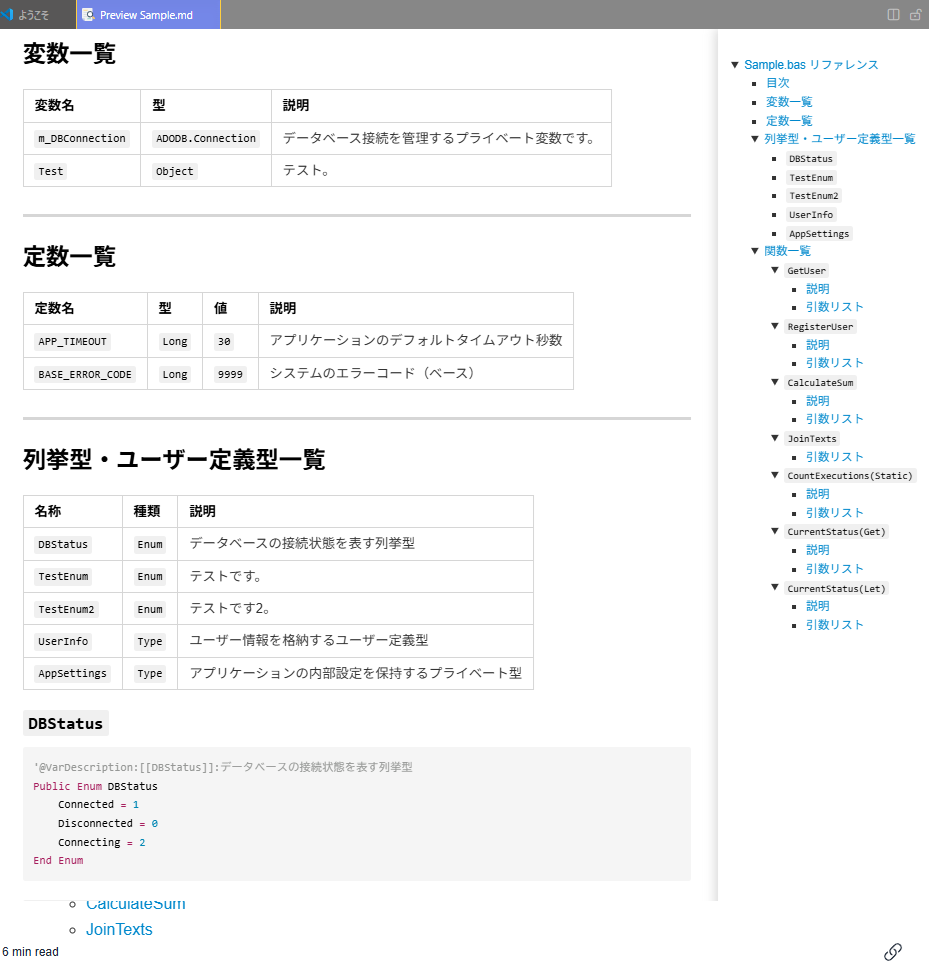
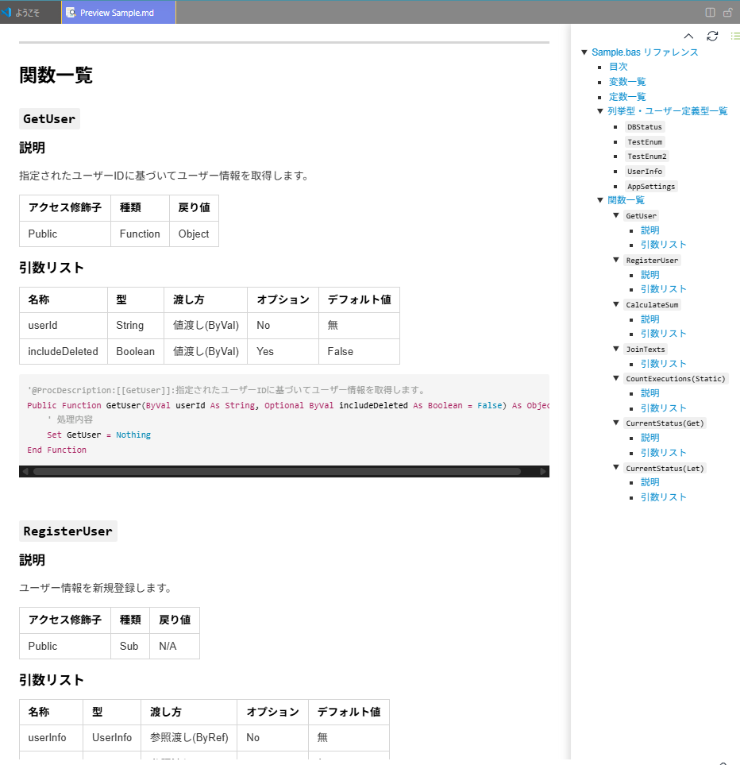
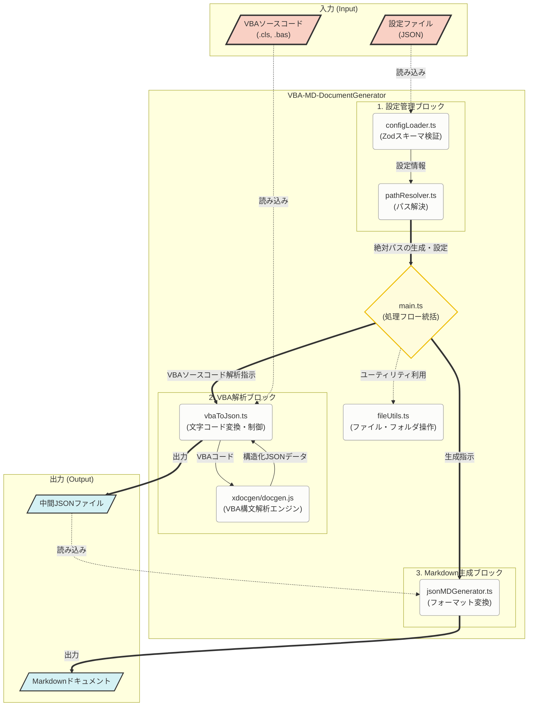

# VBA-MD-DocumentGenerator

---

## 📔 概要

本ツールはVBA (Visual Basic for Applications) のソースコードから、マークダウン形式のAPIリファレンスドキュメントを自動生成するCLIツールです。
外部からお借りしたXDocGenというプログラムを改修し、自作のプログラムと組み合わせて作成しました。

解析されたソースコードをJSONに変換し、更にJSONからマークダウン形式のファイルに変換しドキュメントを出力します。

> [!WARNING]
> 本ツールは別途、個人で作成しているVBAプロジェクトのドキュメント化を一任するために作成したものです。
> そのため、あらゆる状況を想定した**動作保証はしていません**。あらかじめご承知おきください。

<table align="center" width="100%">
  <tr>
    <td align="center" width="50%">
      <strong>ターミナルでの実行デモ (GIF)</strong>
      <a href="./assets/termdemo.gif" target="_blank">
      <kbd></kbd>
      </a>
    </td>
    <td align="center" width="50%">
      <strong>生成されたMarkdownドキュメント</strong>
      <a href="./assets/mdSample.png" target="_blank">
      <kbd></kbd>
      </a>
    </td>
  </tr>
    <tr>
    <td align="center" width="50%">
      <strong>各要素の一覧を表で出力</strong>
      <a href="./assets/mdSample2.png" target="_blank">
      <kbd></kbd>
      </a>
    </td>
    <td align="center" width="50%">
      <strong>該当部分のソースコードの抽出</strong>
      <a href="./assets/mdSample3.png" target="_blank">
      <kbd></kbd>
      </a>
    </td>
  </tr>
</table>

---

## 📜 目次

- [🌟 特徴](#-特徴)
- [📂 ディレクトリ構成](#-ディレクトリ構成)
- [🚀 動作環境](#-動作環境)
- [🛠️ セットアップ](#-セットアップ)
- [⚙️ 設定ファイルについて](#️-設定ファイルについて)
- [📊 システム構成図](#-システム構成図)
- [💻 実行方法](#-実行方法)
- [📝 タグについて](#-タグについて)
  - [✅ 前提](#-前提)
  - [📦 モジュールレベルタグ](#-モジュールレベルタグ)
  - [📦 変数・定数・列挙型・ユーザー定義型レベルタグ](#-変数定数列挙型ユーザー定義型レベルタグ)
  - [⚙️ プロシージャレベルタグ](#️-プロシージャレベルタグ)
- [🧪 テストとドキュメント生成](#-テストとドキュメント生成)
- [⚙️ 開発ノート](#️-開発ノート)
- [📄 ライセンス](#-ライセンス)
- [📄 使用させていただいたプログラム](#-使用させていただいたプログラム)

---

## 🌟 特徴

- **自動ドキュメント生成**: VBAファイル内のプロシージャ、変数、定数を自動解析してテーブルやリスト形式のMarkdownに変換します。
- **TypeScript & Node.js**: TypeScriptで開発し、Node.js環境で動作します。
- **Zodによるスキーマ検証**: 設定ファイルや中間出力されるJSONファイルの構造をZodを用いて厳密に検証し、実行時の予期せぬエラーを防ぎます。
- **柔軟な設定**: 処理対象のフォルダパスや拡張子などをJSONファイルで柔軟に設定可能です。

---

## 📂 ディレクトリ構成

プロジェクトの主要なディレクトリ構成は以下の通りです。

```text
VBA-MD-DocumentGenerator/
├── assets/                  # README用画像・デモGIFなど
├── src/                     # TypeScriptソースコード
│   ├── main.ts              # エントリーポイント
│   ├── vbaToJson.ts         # VBAからJSONへの変換処理
│   ├── jsonMDGenerator.ts   # JSONからMarkdownへの変換処理
│   ├── config.schema.ts     # Zodによる設定スキーマ定義
│   ├── constants.ts         # 定数定義
│   └── ...                  # その他パス解決やファイル操作ユーティリティなど
├── xdocgen/                 # VBA解析コアエンジン (JavaScript)
│   ├── docgen.js            # コアスクリプト
│   └── docgen.d.ts          # TypeScript向け型定義ファイル
├── tests/                   # Jestテストコード
├── srcFiles/                # (デフォルト入力) 解析対象VBAファイルの配置先
├── docs/                    # (TypeDoc出力) APIリファレンスドキュメント
├── out/                     # (デフォルト出力) 生成物格納先
│   ├── json/                # 中間生成されたJSONファイル
│   └── md/                  # 最終生成されたMarkdownドキュメント
├── dist/                    # (ビルド出力) コンパイル済みJavaScriptファイル
│   ├── src/                 # TypeScriptソースコードのコンパイル結果
│   └── xdocgen/             # VBA解析コアエンジンのファイル
├── vba-md-doc-config.sample.json  # メイン設定ファイルのサンプル
└── vba-md-doc-env.sample.json     # 環境設定ファイルのサンプル
```

---

## 🚀 動作環境

- <u>**実行環境**</u>
  - Node.js (v18以上推奨)

- <u>**パッケージマネージャー**</u>
  - pnpm (または npm)  
  
> [!NOTE]
> npmでの動作確認はしていません。

---

## 🛠️ セットアップ

リポジトリをクローンした後、以下の手順で環境を構築してください。

```bash
# 1. パッケージのインストール
pnpm install
# (npmをご利用の場合: npm install)

# 2. 設定ファイルの準備
# サンプルファイルをコピーして、ご自身の環境に合わせて設定ファイルを作成します
cp vba-md-doc-env.sample.json vba-md-doc-env.json
cp vba-md-doc-config.sample.json vba-md-doc-config.json

# 3. TypeScriptのコンパイル（ビルド）
pnpm run build
# (npmをご利用の場合: npm run build)
```

---

## ⚙️ 設定ファイルについて

本ツールは2つの設定ファイルを使用します。サンプルファイル(`.sample.json`)をコピーして、ご自身の環境に合わせて編集してください。

### 1. `vba-md-doc-env.json`

ツールの起動時に最初に読み込まれる環境設定ファイルです。

> [!IMPORTANT]
> 基本的には**変更不要**です。

| 項目 | 説明 | デフォルト値 |
| --- | --- | --- |
| `targetConfig.resolveBootConfigPath` | ツール本体の設定ファイルへのパスを指定します。 | `"vba-md-doc-config.json"` |
| `targetConfig.bootConfigKey` | パスを解決するためのキー名です（変更不要）。 | `"resolveBootConfigPath"` |

### 2. `vba-md-doc-config.json`

ツールの主要な動作設定を行うファイルです。入出力フォルダや対象の拡張子などを変更したい場合はここを編集します。

#### `ioPaths` (入出力パスの設定)

| 項目 | 説明 | デフォルト値 |
| --- | --- | --- |
| `sourcePaths.srcFiles` | 解析対象のVBAファイルを配置する入力フォルダのパスです。 | `"srcFiles"` |
| `outputPaths.temp` | 処理中に使用する一時フォルダのパスです。 | `"temp"` |
| `outputPaths.out` | 出力先のルートフォルダのパスです。 | `"out"` |
| `outputPaths.json` | 中間生成されるJSONファイルの出力先フォルダのパスです。 | `"out/json"` |
| `outputPaths.markdown` | 最終的なMarkdownドキュメントの出力先フォルダのパスです。 | `"out/md"` |

#### `params` (実行パラメーターの設定)

| 項目 | 説明 | デフォルト値 |
| --- | --- | --- |
| `extension` | 解析対象とするファイルの拡張子を指定します。(`.cls`, `.bas` など) | `".cls"` |
| `markdownFlg` | Markdownファイルを出力するかどうかのフラグです。(`"true"` または `"false"`) | `"true"` |

#### `implementationsPaths` (プログラム内部のパス設定)
このセクションはプログラム内部で利用するスクリプトのパス定義です。

> [!WARNING]
> **基本的に変更しないでください**。
> ビルド出力先ディレクトリ（`dist`）などを変更した場合のみ調整が必要です。

---

## 💻 実行方法

設定ファイル (`vba-md-doc-config.json`) の `ioPaths.sourcePaths.srcFiles` に指定したフォルダ（デフォルトは `srcFiles`）にVBAファイル(`.cls`, `.bas` など) を配置し、以下のコマンドを実行します。

```bash
pnpm start
```

実行が完了すると、設定した出力先ディレクトリ（デフォルトは `out/md`）にMarkdownファイルが生成されます。

---

## 📊 システム構成図

本ツールのモジュール依存関係と、ファイル（データ）の流れをまとめた図です。

<details>
  <summary><kbd>図を表示(クリック)</kbd></summary>

> [!TIP]
> プロジェクトの全体像を正確に把握していただくため、構成情報を基にAIを用いて生成したマーメイド図（構成図）を掲載しています。



</details>

---

## 📝 タグについて

### ✅ 前提

> [!IMPORTANT]
> タグは、**対象となる要素（変数、定数、プロシージャなど）の直上にタグを記述する**ことを前提としています。
> `'@タグ名: 値` や `'@タグ名:[[要素名]]: 値` などの形式で記述することで、Markdownドキュメントに詳細情報が反映されます。

> [!NOTE]
> プロシージャ、メソッド･定数･Enum･Typeなど一部の要素はタグ無しでドキュメント化されます。(以下の一覧に含まれないものは基本的に自動出力です。)
> 任意の説明はDescription系のタグで追加してください。
  
下記に使用可能なタグの一覧を記載します。
なお、実際のソースコードで実際にタグを用いた詳細なサンプルは `\srcFiles\Sample.bas` です。
そちらも併せてご参考ください。

---

### 📦 モジュールレベルタグ

ソースコードの先頭付近に(`Option Explicit`の直後など)記述し、モジュール･クラスそのものに関する情報を定義します。

| タグ名 | 説明 | 記述例 |
| --- | --- | --- |
| `@Description` | モジュール･クラスの説明を記述します。 | `'@Description:DB接続を管理するモジュールです。` |
| `@Author` | 作成者名やバージョンなどを記述します。 | `'@Author:山田 太郎` |
| `@ToDo` | 今後の課題や修正予定を記述します。 | `'@ToDo:エラーハンドリングの強化` |
| `@LastUpdate` | 最終更新日 | `'@LastUpdate:1900/01/01` |
| `@ModuleName` | ファイル名とは異なるモジュール名を明示したい場合に使用します。(通常はファイル名から自動出力されます。) | `'@ModuleName: DatabaseManager` |

#### 🐧記述例

```vb
Option Explicit

'@Description: VBA-MD-DocumentGeneratorでサポートしている全てのタグと機能を網羅したサンプルモジュールです。
'このファイルを参考に、タグの使用方およびどのようなドキュメントが生成されるかご確認ください。
'@Author:山田 太郎
'@ToDo:サンプルコードのレビュー
'@LastUpdate:2026/03/21
'@ModuleName:SampleModule
```

---

### 📦 変数・定数・列挙型・ユーザー定義型レベルタグ

対象となる変数、定数(`Const`)、列挙型(`Enum`)、ユーザー定義型(`Type`)の**直上**に記述し、その詳細を定義します。

> [!WARNING]
> タグの前後にスペースを入れるとうまく解析できないため、左詰めかつ内容は`@Tag:`の直後から記述してください。

> [!IMPORTANT]
> 重要な変数のみをドキュメント化する設計としているため、**@Var～系のタグを変数の直上に3つ記述することを必須としています**。

> [!NOTE]
> 定数(`Const`)、列挙型(`Enum`)、ユーザー定義型(`Type`)は基本的に自動解析されますが、任意の説明のみタグを用いて記述します。

| タグ名 | 説明 | 記述例 |
| --- | --- | --- |
| `@VarName` | 変数の名前。（※通常の変数でのみ必須） | `'@VarName: m_DBConnection` |
| `@VarType` | 変数の型。（※通常の変数でのみ必須） | `'@VarType: ADODB.Connection` |
| `@VarDescription` | 変数の説明を記述します。（※通常の変数でのみ必須） | `'@VarDescription: データベース接続オブジェクト` |
| `@VarDescription[[名前]]:` | 定数･列挙型･ユーザー定義型の説明を記述します。`[[名前]]`は各要素を識別するために必須です。 | `'@VarDescription:[[Sample]]:定数の説明です。` |

#### 🐧記述例

```vb
' 【 変数 】
' 以下のように変数宣言の上から3つのタグを記述してください。
'@VarName:m_DBConnection
'@VarType:ADODB.Connection
'@VarDescription:データベース接続を管理するプライベート変数です。
Private m_DBConnection As Object

' 【 Enum 】
'@VarDescription:[[DBStatus]]:データベース接続状態を表す列挙型です。
Public Enum DBStatus
    Connected = 1
    Disconnected = 0
End Enum

' 【 定数 】
'@VarDescription:[[APP_TIMEOUT]]:アプリケーションのデフォルトタイムアウト秒数です。
Public Const APP_TIMEOUT As Long = 30

' 【 Type 】
'@VarDescription:[[UserInfo]]:ユーザー情報を格納するユーザー定義型です。
Public Type UserInfo
    ID As String
    Name As String
    Age As Integer
End Type
```

---

### ⚙️ プロシージャレベルタグ

各プロシージャ（Sub / Function / Property）の直上に記述し、その詳細を定義します。

> [!NOTE]
> - 各プロシージャは原則自動的に解析されるため、タグは必要としませんが、任意のコメントは`＠ProcDescription:[[プロシージャ名]]:タグ`を使って記述する必要があります。
> - 基本的な使用方法は定数(`Const`)、列挙型(`Enum`)、ユーザー定義型(`Type`)のものと同じです。

| タグ名 | 説明 | 記述例 |
| --- | --- | --- |
| `@ProcDescription:[[プロシージャ名]]:` | プロシージャの補足説明を任意に追加できます。 | `'@ProcDescription:[[init]]:初期化処理` |

**記述例:**

```vb
'【 Function 】
'@ProcDescription:[[GetUser]]:指定されたユーザーIDに基づいてユーザー情報を取得します。
Public Function GetUser(ByVal userId As String, Optional ByVal includeDeleted As Boolean = False) As Object
    ' 処理内容
    Set GetUser = Nothing
End Function

'【 Sub 】
'@ProcDescription:[[RegisterUser]]:ユーザー情報を新規登録します。
Public Sub RegisterUser(ByRef userInfo As UserInfo, ByRef resultMsg As String)
    ' 処理内容
    resultMsg = "Success"
End Sub

' 【 プロパティ 】
'@ProcDescription:[[CurrentStatus]]:現在のステータスを取得します。
Public Property Get CurrentStatus() As DBStatus
    CurrentStatus = DBStatus.Connected
End Property
```

---

## 🧪 テストとドキュメント生成

**単体テストの実行 (Jest)**
```bash
pnpm test
```

**APIドキュメントの生成 (TypeDoc)**
```bash
pnpm run docs
```
生成されたHTMLドキュメントは `docs/` フォルダに出力されます。

---

## ⚙️ 開発ノート

- **依存関係の固定**: 安定動作のため、`package.json` で依存パッケージのバージョンを厳密に固定しています。
- **環境の分離**: 実行パスなどを記述する設定ファイルは `.gitignore` に登録し、リポジトリには `.sample.json` のみを含めることで、環境依存コードの混入を防いでいます。
<br>

### 📂 ビルド時のディレクトリ構成
本プロジェクトでは、TypeScriptのソース(`src/`)と、依存するJSモジュール(`xdocgen/`)が並列に配置されています。
ビルド後もファイル間の相対パス関係を正しく維持するため、TypeScriptのコンパイル設定 (`tsconfig.json` の `rootDir`) はプロジェクトルート (`.`) に設定されています。

> [!WARNING]
> ビルドされた実行ファイルは `dist/main.js` ではなく `dist/src/main.js` に出力される仕様となっています。
> デバッグ設定などを変更する際はご注意ください。

---

## 📄 ライセンス

本ツールは **MIT ライセンス** のもとで公開されています。詳細は `LICENSE.md` をご確認ください。

## 📄 使用させていただいたプログラム
本プログラムでは、VBA（Excelなどの自動化プログラム）を読み取る仕組みとして、**Anthony Mancini氏**が作った **XDocGen** をもとに、独自の機能追加を行って使用しています。素晴らしいアイデアとコードに深く感謝いたします。
